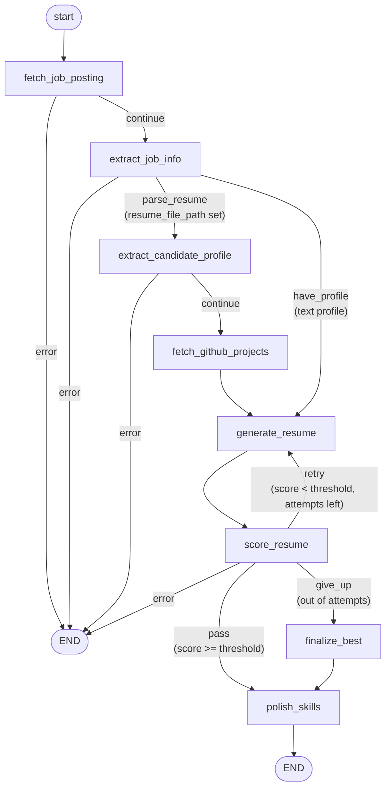

# Pipeline (`job_resume_langgraph.py`)

The pipeline is a LangGraph `StateGraph` over a single `ResumeState`
TypedDict. Each node takes the full state and returns an updated copy
(`{**state, ...}`).

## Graph



Note that **GitHub enrichment only runs when a resume file is provided**.
The text-profile path goes straight from `extract_job_info` to
`generate_resume`.

## Running it

```python
import sqlite3
from langgraph.checkpoint.sqlite import SqliteSaver
from job_resume_langgraph import build_graph

conn = sqlite3.connect("resume_pipeline_checkpoints.db", check_same_thread=False)
app = build_graph(checkpointer=SqliteSaver(conn))   # or build_graph() for a stateless run

final = app.invoke(
    {
        "job_url": "https://example.com/jobs/123",
        "resume_file_path": "old_resume.pdf",   # OR "candidate_profile": "free text..."
        "ats_threshold": 80,
        "max_attempts": 3,
    },
    config={"configurable": {"thread_id": "my-run-1"}},
)
print(final["resume_output"])
```

`build_graph(fetch_node=..., checkpointer=...)`:

| Parameter | Default | Options |
|---|---|---|
| `fetch_node` | `fetch_job_posting_firecrawl` | `fetch_job_posting` (requests + BeautifulSoup), `fetch_job_posting_playwright` (headless Chromium) |
| `checkpointer` | `None` (stateless) | Any LangGraph checkpointer, e.g. `SqliteSaver(conn)` |

You can also run `python job_resume_langgraph.py` directly. The `__main__`
block has a sample run. Edit `resume_file_path`, `job_url`, and `thread_id`
there first.

To inspect what each node did on a checkpointed thread:

```python
for snapshot in app.get_state_history(config):
    print(snapshot.metadata.get("writes"), snapshot.next)
```

## State schema (`ResumeState`)

### Inputs

| Field | Type | Description |
|---|---|---|
| `job_url` | `str` | **Required.** URL of the job posting. |
| `resume_file_path` | `str` | Path to an old resume (`.pdf`/`.docx`/`.txt`/`.md`). If set, it is used instead of `candidate_profile`. |
| `candidate_profile` | `str` | Free-text background. Used only when `resume_file_path` is not set. When a file is parsed, this field is overwritten with a structured summary. |
| `ats_threshold` | `int` | Score needed to pass. Default `80`. |
| `max_attempts` | `int` | Maximum generate→score cycles. Default `3`. |

### Job fields (set by `fetch_job_posting*` / `extract_job_info`)

| Field | Type | Description |
|---|---|---|
| `raw_job_text` | `str` | Scraped text or Markdown, truncated to 15,000 characters. |
| `company_name`, `job_role`, `job_description` | `str` | Extracted job details. |
| `key_responsibilities`, `requirements` | `list[str]` | Extracted bullets (inferred from prose when the posting has no lists). |

### Candidate fields (set by `extract_candidate_profile` / `fetch_github_projects`)

| Field | Type | Description |
|---|---|---|
| `raw_candidate_resume_text` | `str` | Raw text extracted from the file, truncated to 8,000 characters. |
| `candidate_name` | `str` | |
| `candidate_skills`, `candidate_experience`, `candidate_education`, `candidate_certifications` | `list[str]` | Structured résumé content. |
| `github_url` | `str` | Found by the LLM, or by the regex fallback. |
| `github_projects` | `list[dict]` | Up to 5 repos: `name`, `description`, `language`, `url`, `stars`, `relevance_score`. |
| `github_note` | `str` | Explains the GitHub result (for example, why it is empty). |

### Output / scoring fields

| Field | Type | Description |
|---|---|---|
| `resume_output` | `str` | The tailored resume in Markdown. |
| `ats_score` | `int` | Final, capped score for the reported attempt. |
| `ats_raw_llm_score` | `int` | The model's own score before the cap. |
| `ats_keyword_coverage` | `int` | `matched / (matched + missing) * 100`, rounded. |
| `ats_feedback` | `str` | The scorer's actionable feedback, fed into retries. |
| `matched_keywords`, `missing_keywords` | `list[str]` | Short, atomic keywords. |
| `attempt_count` | `int` | Number of scoring cycles run. |
| `best_score`, `best_resume`, `best_matched_keywords`, `best_missing_keywords`, `best_feedback`, `best_raw_llm_score`, `best_keyword_coverage` | various | The best attempt's full set of results, kept together so it stays consistent. |
| `final_note` | `str` | Set when the threshold was never reached, or when polishing failed. |
| `error` | `str \| None` | Set by any node that fails. Downstream nodes skip and the graph ends. |

## Nodes

### `fetch_job_posting_firecrawl` (default)

- Needs `FIRECRAWL_API_KEY`. The node errors out right away if it is missing.
- `POST https://api.firecrawl.dev/v1/scrape` with
  `{"formats": ["markdown"], "onlyMainContent": true, "waitFor": 2000}`,
  30 s timeout.
- Errors if Firecrawl reports `success: false`, or if fewer than 200
  characters of Markdown come back.
- Stores up to 15,000 characters in `raw_job_text`.

### `fetch_job_posting` (alternative)

- Plain `requests.get` with a desktop Chrome User-Agent and a 15 s timeout,
  parsed with BeautifulSoup's `html.parser`. Removes `script`, `style`,
  `nav`, `footer`, `header`, and `noscript` tags.
- Errors when fewer than 200 characters are extracted, which usually means
  the page is JavaScript-rendered or blocks bots.

### `fetch_job_posting_playwright` (alternative)

- Headless Chromium, `domcontentloaded` plus a 2 s settle wait, then the
  same cleanup as above.
- Needs `pip install playwright && playwright install chromium`. This is
  **not** in `requirements.txt` or the Docker image.

### `extract_job_info`

- Model: `gpt-4o-mini`, temperature 0, `max_tokens=1000`, forced to call the
  `JobInfo` tool.
- The prompt asks the model to break prose into 3–8 bullets for
  responsibilities and requirements when the posting has no explicit lists,
  and never to invent facts.

### `extract_candidate_profile`

- `load_text_from_file(path)` reads:
  - `.pdf` with `pypdf.PdfReader`, page by page
  - `.docx` with `python-docx`, paragraph text only (tables, headers, and
    text boxes are **not** read)
  - `.txt` / `.md` as UTF-8, ignoring decode errors
  - anything else raises `ValueError` and the run fails
- Fewer than 50 characters of text → error (usually a scanned PDF that needs OCR).
- Model: `gpt-4o-mini`, temperature 0, `max_tokens=1500`, forced to call the
  `CandidateProfile` tool. The model is told to extract only what is
  actually written.
- If the model misses the GitHub link, a regex fallback looks for
  `https?://(www.)?github.com/<user>` in the raw text.
- Rebuilds `candidate_profile` as a clean text block (Name / Summary /
  Skills / Experience / Education / Certifications/Projects), which
  `generate_resume` reads.

### `fetch_github_projects`

- Skips with a note if there is no GitHub URL or no username can be parsed
  from it.
- `GET https://api.github.com/users/{username}/repos?sort=updated&per_page=100&type=owner`,
  authenticated with `GITHUB_TOKEN` when it is set. 15 s timeout.
- Drops forks. Each repo is scored by how many keywords appear in
  `name + description + language + topics`, case-insensitive. The keywords
  are the job's requirements and responsibilities plus the candidate's
  skills, each under 40 characters.
- Sorts by (relevance, stars), keeps the top 5, and drops any repo with a
  relevance of 0 **and** 0 stars.
- **Never sets `error`.** Failures are written to `github_note`.

### `generate_resume`

- Model: `gpt-4o-mini`, temperature 0.3, `max_tokens=2000`.
- Input: the job details, the candidate background, the GitHub projects (if
  any), and on retries the previous score, missing keywords, and reviewer
  feedback.
- The system prompt requires tailoring to each responsibility and
  requirement, ordering by relevance, ATS-friendly Markdown, and **never
  fabricating** experience. The fixed section order is:
  `# Name`, `## Summary`, `## Skills`, `## Experience`, `## Education`,
  `## Projects`, then optionally `## Certifications`.

### `score_resume`

- Model: **`gpt-4o`**, temperature 0, `max_tokens=800`, forced to call the
  `ATSScore` tool.
- The prompt gives a rubric (0–40 / 41–60 / 61–75 / 76–89 / 90–100) tied to
  keyword coverage, plus a worked example of short, atomic keywords.
- **Sanity cap:**
  ```
  keyword_coverage = round(matched / (matched + missing) * 100)   # 100 if both lists empty
  ats_score        = min(raw_llm_score, keyword_coverage + 10)
  ```
- Increments `attempt_count` and updates the `best_*` fields when this
  attempt beats the previous best.

### `finalize_best`

Runs only when attempts run out before the threshold is reached. It restores
the best attempt's resume, score, keywords, and feedback **together** and
sets `final_note`, e.g. *"Did not reach the target ATS score of 80 after 3
attempts. Returning the best-scoring version found (score: 74)."*

### `polish_skills`

- First filters `matched_keywords` with `_looks_like_a_skill_keyword`. It
  rejects entries that are empty, over 40 characters, over 5 words, contain
  a period in the middle, or contain phrases like *"currently pursuing"*,
  *"years of experience"*, *"responsible for"*, or *"ability to"*.
- Model: `gpt-4o-mini` (`get_llm()`). It rewrites **only** the `## Skills`
  section so that every confirmed keyword appears there, and returns the
  full resume.
- If the call fails, the unpolished resume is kept and a note is appended to
  `final_note`.

## Routers

| Function | After | Returns |
|---|---|---|
| `check_error` | `fetch_job_posting`, `extract_candidate_profile` | `"error"` → END, `"continue"` |
| `after_extract_job_info_router` | `extract_job_info` | `"error"`, `"parse_resume"` (file given), `"have_profile"` |
| `check_ats_score` | `score_resume` | `"error"`, `"pass"` (`ats_score >= ats_threshold`), `"give_up"` (`attempt_count >= max_attempts`), `"retry"` |

## LLM call budget per run

| Step | Calls | Model |
|---|---|---|
| Job extraction | 1 | gpt-4o-mini |
| Candidate extraction | 0–1 (file input only) | gpt-4o-mini |
| Generate + score | `attempt_count` × (1 + 1) | gpt-4o-mini + gpt-4o |
| Skills polish | 0–1 (skipped if no valid matched keywords) | gpt-4o-mini |

With the defaults (`max_attempts=3`), a run makes **3 to 9** LLM calls plus
one Firecrawl scrape. Each edit through the API adds 1 generation call, 1
scoring call, and 1 polish call.

## Pydantic tool schemas

- **`JobInfo`**: `company_name`, `job_role`, `job_description`,
  `key_responsibilities[]`, `requirements[]`
- **`CandidateProfile`**: `name`, `summary`, `skills[]`,
  `experience_bullets[]`, `education[]`, `certifications_projects[]`,
  `github_url`
- **`ATSScore`**: `score` (0–100, validated), `matched_keywords[]`,
  `missing_keywords[]`, `feedback`

The `Field` descriptions on these models are sent to the LLM as part of the
tool schema, so they work as prompt instructions too. Edit them with care.
